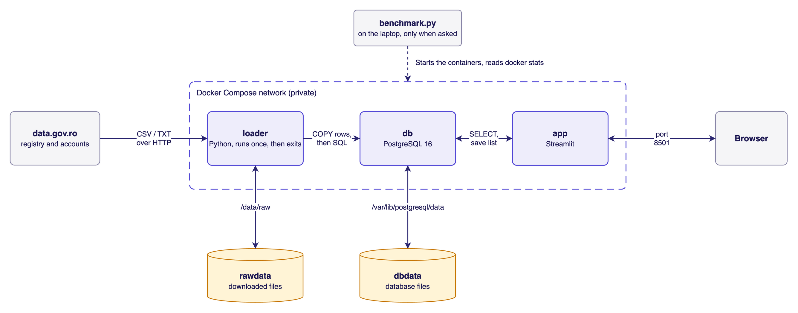

# Romanian IT Career Explorer

## Question

Which IT companies in Romania are worth exploring for my career, based on location, size and how the business has evolved? The app narrows thousands of companies down to a short list worth researching; it is not a ranking.

## Team

Robert Andrei Dintoi, non-attending student, project done alone.

## How to run

Needs Docker and about 5 GB of free disk.

```bash
git clone https://github.com/Robert8903/Romanian-IT-Explorer.git
cd Romanian-IT-Explorer
cp .env.example .env
docker compose up
```

Open <http://localhost:8501> once you see `loader-1 exited with code 0`. The first run downloads 0.73 GB and loads it, about 7 minutes in total on my laptop; later runs skip the load and the app is up in about 45 seconds. For a quicker try, set `SAMPLE_PCT=10` in `.env`. Stop with `Ctrl+C`; **don't run `docker compose down -v`**, it deletes the data and My list. After changing the code: `docker compose build loader app`. Tests and measurements: see `tests/` and `measure/benchmark.py`.

## Data

Trade Registry (ONRC, snapshot 2026-11-04: 4.2 M firms, 4.7 M status rows) and Ministry of Finance annual accounts 2021–2025 (4.5 M company-years), from [data.gov.ro](https://data.gov.ro) under CC BY 4.0. Exact files and row counts are pinned in `loader/sources.py`. Individuals (PF, PFA, II, IF, AF) and street addresses are dropped during the download and never reach the disk.

## Architecture



`db` is PostgreSQL 16: the data is tabular and links through the tax ID (CUI), so the app needs joins, filters and yearly comparisons. `loader` downloads the files, copies them into staging tables with `COPY`, cleans them in SQL (`loader/sql/`) in one transaction and exits. `app` is Streamlit: a county map, Explore, Compare and My list. Only `app` publishes a port. More diagrams in `docs/diagrams/`.

## Measurements

Apple M2, 8 GB RAM, Docker with 8 CPUs and 3.8 GiB. Each size run 3 times from an empty database, files already downloaded; averages shown (raw rows in `measure/results.csv`).

| Measurement | 25% | 50% | 100% |
|---|---|---|---|
| Full load | 30.2 s | 51.7 s | 107.4 s |
| SQL cleaning (part of the load) | 15.2 s | 31.8 s | 76.9 s |
| Peak memory, database / loader | 344 / 32 MiB | 395 / 33 MiB | 551 / 31 MiB |
| Database on disk (files: 0.73 GiB) | 0.76 GiB | 1.47 GiB | 2.92 GiB |
| Explore search, with / without indexes | 3.0 / 24.3 ms | 5.5 / 45.4 ms | 10.3 / 105.9 ms |
| County totals, with / without indexes | 55.8 / 54.9 ms | 110.1 / 107.8 ms | 240.8 / 229.0 ms |

The app container uses 51 MiB idle and peaks at 145 MiB while one user opens every page (full data, 3 runs). Load time grows about in proportion to the data, the loader's memory stays flat because rows are streamed, and indexes speed up the Explore search 10× but not queries that read most of the table.

## Who did what

Everything by Robert Andrei Dintoi.
